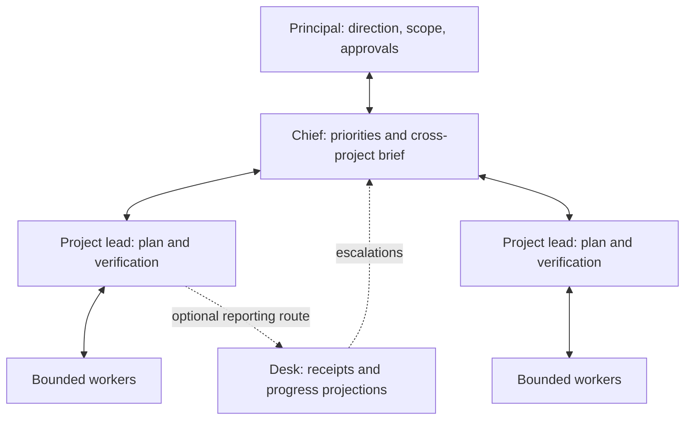

# Chief of staff

<p><a href="assets/workstack-mark-full.png"></a></p>

Chief of staff is an agent kit for people running several projects through AI leads. It keeps a cross-project brief, shapes new work with you, and delegates each agreed outcome to a lead who owns its plan, workers and verification.

Project decisions get lost when they live only in a conversation. Chief keeps priorities, open questions and standing permissions in files. Leads keep project detail in their own `LEAD.md`. Checkpoint instructions prepare either role to resume in a fresh session.



The principal sets authority and approves plans before implementation. Chief coordinates outcomes; leads decide technical details within the agreed scope. Workers ask their lead when blocked. The optional desk files reports and prepares progress updates; it has no independent approval authority. [Roles](ROLES.md) covers the reporting boundaries.

## What ships

- Chief and lead instruction templates for OpenCode/OpenChamber, Claude Code, Codex and Pi 1.0.
- `shape` for agreeing a project's purpose and scope; `checkpoint` for durable state and handover.
- Engineering and research lead practices, plus an on-demand upstream-courtesy skill that requires approval before posting.
- Optional scoped OpenCode profiles, desk modules and quota-aware Runway routing.

The separate [lead-kit](https://github.com/batteryshark/lead-kit) is for one accountable project lead without a Chief. This repository includes the current lead core in `kits/lead/` and can also render a standalone lead. Chief adds cross-project coordination, principal-facing conversation, memory and shaping.

## Requirements

Basic rendering and installation use Bash and Python 3.10+ with the standard library. Install your host application separately, with an available model and the tools/permissions your workflow needs. Instruction files don't supply model access or credentials.

OpenCode/OpenChamber is the runtime integration target for session dispatch, goal mode, scoped permissions and native desk adapters. Claude Code receives agent/output-style/skill files; its session workflow needs the optional `chief-openchamber` helper and an installed macOS OpenChamber app. Codex receives instruction fragments and skills: connect the fragments using your Codex version's supported configuration. These hosts don't have equivalent runtime capabilities.

Pi 1.0 uses prompt templates and skills in `~/.pi/agent`. It needs Node.js 22.19.0+ and a separately configured model. Optional Pi packages add delegation and goal tracking; Chief's durable external-session dispatch and desk adapters remain OpenCode/OpenChamber integrations. See [Pi setup](docs/pi.md) for pinned prerequisites and the supported handover paths.

Voice needs a separately configured voice integration. Fleet, Docket, Tarmac, Voicestack and a2a are external services or plugins. The kit doesn't provision them, accounts or background services. See [shared services](services/README.md).

## Setup

From a checked-out copy, inspect the output first:

```sh
./install.sh --print opencode
./install.sh --dry-run opencode
./install.sh opencode
```

Select `chief-of-staff` in the host's agent selector. Start by asking it to shape a project; review the resulting scope and plan before implementation. Configure your model policy, tool access and a real current-session pointer before delegating.

Host files go under `~/.config/opencode`, `~/.claude` or `~/.codex`. The installer creates Chief's brief and memory seeds under `~/.chief-of-staff`; set `CHIEF_BRIEF_DIR` to choose another memory location. `opencode` installs agent/command/skill files and seeds memory, but doesn't install helpers or start the host.

```sh
./install.sh claude codex bin home
./install.sh --uninstall opencode claude codex bin home
```

`bin` installs `chief-openchamber` and `chief-portfolio` into `~/.local/bin`; add it to `PATH` if needed. `OPENCHAMBER_APP` can select a nondefault app location. With no arguments, the installer selects the three original hosts, helpers and home files. Pi requires its explicit preset.

### Pi 1.0

Preview and install Chief with the included engineering/research lead:

```sh
./install.sh --profile pi --print
./install.sh --profile pi --dry-run
./install.sh --profile pi
```

Start Pi in the Chief brief folder (`~/.chief-of-staff` by default) and invoke `/chief-of-staff`. In a project's Pi conversation, invoke `/chief-lead <approved objective>`. `/skill:chief-shape` records agreed scope and plan; `/skill:chief-checkpoint` and `/skill:chief-lead-checkpoint` prepare handover. Run `/reload` after changing resources in an open session. Load the role template again in every fresh conversation.

Base Pi does permitted work with its available tools. Under Pi, you can independently opt into instructions for operator-installed `pi-subagents` and `pi-goal-x`:

```sh
./install.sh --profile pi --pi-capability pi-subagents --pi-capability pi-goal-x --print
./install.sh --profile pi --pi-capability pi-subagents --pi-capability pi-goal-x
./install.sh --profile pi --uninstall
```

Omit either flag to select just one package. Repeat installation with no flags to return to base instructions. These commands install kit resources only; they never install or activate packages or goals. Delegation uses pi-subagents child runs; a separate main Pi lead reports locally to the principal. Persistent external-Chief handoff and OpenChamber goal wakeups aren't provided. [Pi setup](docs/pi.md) covers package installation, child semantics and ownership limits.

Managed files carry an ownership marker. Existing unowned files are skipped or refused. Uninstall retains personal briefs and memory seeds. Review destinations before installing: the legacy shell installer isn't a transactional filesystem sandbox. Scoped and standalone installers additionally reject symlinked destination descendants. Reinstalling files doesn't refresh an already-running conversation.

### A lead without Chief

```sh
./install.sh --lead-config examples/principal.json --print opencode
./install.sh --lead-config examples/principal.json opencode
./install.sh --lead-config examples/principal.json --uninstall opencode
```

The JSON selects a lead name, practice packs and either direct-principal reporting or an explicit agent-owner pointer. It installs that lead and a namespaced checkpoint without Chief memory. [Kit configuration](kits/README.md#standalone-config) describes the contract and path guards.

## Optional modules

Runway uses Tarmac's passive quota snapshot, validates configured model routes and records admissions/checkpoints in SQLite. It returns dispatch arguments; the caller sends the prompt. It doesn't buy credits, redeem resets or dispatch workers itself. Build prerequisites are Node.js 22+, npm and the locked dependencies:

```sh
npm ci
npm run build
./install.sh --routing opencode
```

This downloads dependencies and adds a local OpenCode plugin/settings entry. Review `routing/routes.example.json` against your own catalog and quota windows before use; blank account fields aren't configured accounts. [Routing workflow](routing/WORKFLOW.md) covers prepare, dispatch, bind and finish. Routing removal requires removing its settings entry and reconciling its owned launcher/ledger separately.

Scoped profiles create separate local OpenCode bundles. They require an explicitly supplied a2a module and operator bindings for goal-mode calls. Host permission filters aren't a security sandbox. See [scoped configuration](kits/README.md#scoped-profiles).

The desk includes durable receipts, report routing, bounded decision rules, a native host adapter and an opt-in filing-only receiver. Filing-only mode prepares status/digest updates and forwards questions to Chief; it doesn't answer them. Native actions need authenticated host bindings and explicit activation. Classifier schemas can't establish semantic reliability. Start with the [desk guide](kits/README.md#optional-desk), [filing receiver](kits/chief/desk/filing/README.md) and [native contract](hosts/desk-native/CONTRACT.md); basic installation enables none of these routes.

## Source and checks

`kits/` holds role instructions and desk code, `profiles/` and `practices/` supply composition, `hosts/` supplies adapters, and `scripts/` contains renderers/installers. `runway/` holds routing policy and ledger code. `tests/` contains offline fixtures; native scripts under `scripts/test-*-native.mjs` and `scripts/test-runtime.mjs` start local services and require separate setup.

For the bounded offline release checks, use Python 3.10+ and a disposable HOME/TMPDIR. Run from the repository root:

```sh
PYTHONPATH=scripts:tests python3 -B -m unittest \
  test_desk_rules.BoundedRulesTests test_optional_filing.FilingTests \
  test_modular.ModularTests.test_principal_standalone_install_all_hosts_without_chief
```

These use synthetic data and fixture destinations, including a fake-HOME install/uninstall. `npm test` selects the bounded release suite, including additional filing-policy and configuration checks. `npm run test:development` retains the wider suite, including optional dependency tests and historical parity fixtures requiring commits from the development repository. Native runtime/goal-mode acceptance must be checked on your configured host separately.

## License

Owned source and documentation are [MIT licensed](LICENSE). The included AI-generated comic artwork is offered under MIT to the extent applicable, without a claim of exclusive copyright in AI-generated material. [Rights](RIGHTS.md) and [dependency notices](THIRD_PARTY_NOTICES.md) describe the scope.
